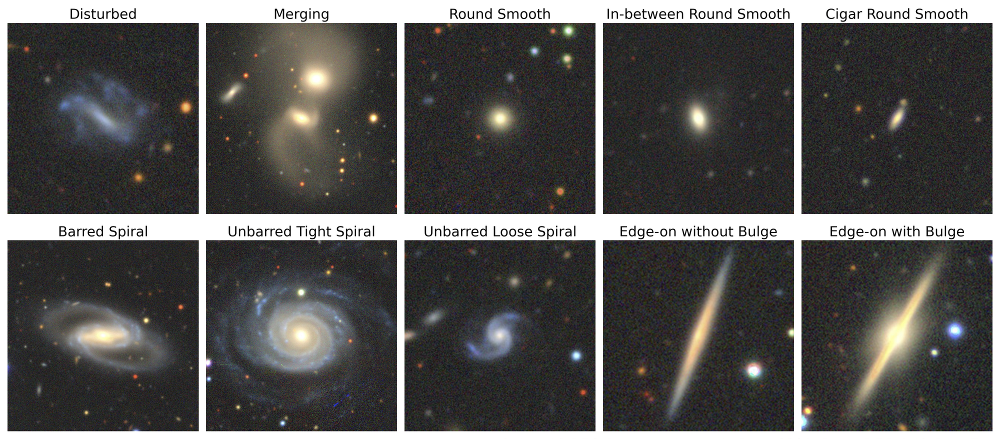

# Galaxy Morphology Classification

Classifying galaxy images into 10 morphological classes on Galaxy10 DECaLS, comparing handcrafted features, ImageNet-pretrained CNNs and a Galaxy Zoo-pretrained encoder under one reproducible, leakage-free protocol. Every number below is generated from the committed experiment logs.

This repository is a revised version of a university course project (Machine and Deep Learning, 2023). The original project is kept on branch [`legacy/v1`](https://github.com/GiulioRusso/Galaxy-Morphology-Classification/tree/legacy/v1) (tag `v1-coursework`).

<!-- HEADLINE:START -->
**Best model (by validation macro-F1): Zoobot ConvNeXt-Tiny (Galaxy Zoo). Test macro-F1 0.860 on all 10 classes.**
<!-- HEADLINE:END -->



## Task

Given a colour image of a galaxy, predict its morphological class: smooth (round, in-between, cigar), spiral (barred, tight, loose), edge-on (with or without bulge), disturbed or merging. Morphology traces how a galaxy formed and evolved, and modern surveys image far more galaxies than people can label, so automatic classification is needed at scale.

## Dataset

[Galaxy10 DECaLS](https://astronn.readthedocs.io/en/latest/galaxy10.html) (Leung & Bovy, astroNN) contains 17,736 images from the DESI Legacy Imaging Surveys (DECaLS):

- **Images:** 256×256 pixels, 3 channels from the g, r and z bands, at 0.262″ per pixel (about 67″ across), stored as 8-bit RGB in one HDF5 file (2.7 GB), with sky coordinates (RA, Dec) for each galaxy.
- **Labels:** derived from [Galaxy Zoo DECaLS](https://data.galaxyzoo.org/) (Walmsley et al. 2022) volunteer votes. A galaxy gets a class when enough volunteers agree on the answers that define it; galaxies without a clear majority are not in the dataset.
- **Imbalance:** classes range from 334 to 2,645 images.

All 10 classes are used. Counts are generated from `splits/`:

<!-- DATASET:START -->
| Class | Name | Release | Used |
|---|---|---|---|
| 0 | Disturbed | 1081 | 1051 |
| 1 | Merging | 1853 | 1839 |
| 2 | Round Smooth | 2645 | 2635 |
| 3 | In-between Round Smooth | 2027 | 2021 |
| 4 | Cigar Shaped Smooth | 334 | 333 |
| 5 | Barred Spiral | 2043 | 2038 |
| 6 | Unbarred Tight Spiral | 1829 | 1819 |
| 7 | Unbarred Loose Spiral | 2628 | 2595 |
| 8 | Edge-on no Bulge | 1423 | 1419 |
| 9 | Edge-on with Bulge | 1873 | 1865 |
| | **Total** | **17736** | **17615** |

Dropped (121): 118 identical, conflicting labels, 3 blank. List: `splits/dropped.csv`.
<!-- DATASET:END -->

"Identical, conflicting labels": the release contains 59 pairs of pixel-identical images, and in every pair the two copies carry different classes. Neither label can be trusted, so both copies are dropped. "Blank": images with a single constant pixel value.

## Protocol

- **Cleaning:** blank images and pixel-identical copies with conflicting labels are found by pixel checks and logged, not hardcoded.
- **Overlap groups:** cutouts within 60″ of each other on the sky overlap and share pixels (measured correlation on the overlap ≈ 0.94–0.99). They form one group, and a group never spans two splits.
- **Split:** one stratified 70/15/15 train/validation/test split by group (seed 0), committed as `splits/galaxy10.csv`. Tests check that splits are disjoint and that every class appears in every split.
- **Augmentation:** on the fly, training images only: the D4 dihedral group (90° rotations × flips; galaxies have no preferred orientation), a random 224 crop from the 256 image, and mild brightness and contrast jitter.
- **Metric:** macro-F1 over the 10 classes, plus per-class F1. Accuracy is not reported: with imbalanced classes it is dominated by the large ones.
- **Training:** AdamW with a 30-epoch cosine schedule, no early stopping (validation F1 is noisy while the learning rate is high). Loss is logged for train and validation.
- **Model selection:** the checkpoint with the best validation macro-F1 is kept, and the choice between models also uses validation macro-F1. The test set is read once per run.
- **Class imbalance:** weighted cross-entropy, focal loss and a class-balanced sampler are compared on ResNet-50; the winner by validation macro-F1 is used for ConvNeXt-Tiny and Zoobot.

## Models

| Config (`config/`) | Model |
|---|---|
| `handcrafted_hgb.yaml` | 115 handcrafted shape, texture and colour features + histogram gradient boosting |
| `resnet50_{wce,focal,sampler}.yaml` | ResNet-50 (ImageNet), one config per imbalance strategy |
| `convnext_tiny.yaml` | ConvNeXt-Tiny (ImageNet-12k→1k) |
| `zoobot.yaml` | [Zoobot](https://github.com/mwalmsley/zoobot) ConvNeXt-Tiny (pretrained on Galaxy Zoo); same architecture as ConvNeXt-Tiny, different pretraining |
| `handcrafted_morph_hgb.yaml` | Handcrafted features + 30 morphology measurements + gradient boosting |
| `zoobot_seg_morph.yaml` | Zoobot with the segmentation map as a 4th input channel and the morphology measurements fused into the classifier |

**Segmentation and morphology** (`net/data/segmentation.py`, `net/data/morphology.py`). Each cutout is segmented with standard astronomical source detection (photutils): smooth, threshold at 1.5σ above the sky noise, deblend, and label every pixel as sky, target galaxy (the source at the centre) or other source (stars, neighbours). The threshold follows the sky noise, so faint arms and tidal tails stay in the galaxy region. On that region, [statmorph](https://statmorph.readthedocs.io) measures concentration, asymmetry, smoothness, Gini, M20, Sérsic index and related statistics, and azimuthal Fourier modes give lopsidedness (m=1), bar and two-arm strength (m=2) and higher-order arm structure (m=3, 4) in three radial annuli. All values are rotation invariant. The map is given to the network as an extra channel, so nothing is removed from the image.

## Results

One run per model (seed 0), 10 classes, test set. Validation macro-F1 is the best epoch's, which selected the checkpoint.

<!-- RESULTS:START -->
| Model | Test macro-F1 | Val macro-F1 |
|---|---|---|
| ConvNeXt-Tiny (ImageNet-12k→1k) | 0.854 | 0.863 |
| Handcrafted features + gradient boosting | 0.711 | 0.720 |
| ResNet-50 (ImageNet), balanced sampler | 0.859 | 0.859 |
| ResNet-50 (ImageNet), focal loss | 0.863 | 0.859 |
| ResNet-50 (ImageNet), weighted cross-entropy | 0.862 | 0.859 |
| Zoobot ConvNeXt-Tiny (Galaxy Zoo) | 0.860 | 0.872 |
<!-- RESULTS:END -->

Per-class test F1:

<!-- PERCLASS:START -->
| Class | convnext_tiny | handcrafted_hgb | resnet50_sampler | resnet50_focal | resnet50_wce | zoobot |
|---|---|---|---|---|---|---|
| 0 Disturbed | 0.542 | 0.358 | 0.611 | 0.634 | 0.616 | 0.620 |
| 1 Merging | 0.906 | 0.707 | 0.919 | 0.907 | 0.903 | 0.917 |
| 2 Round Smooth | 0.940 | 0.899 | 0.930 | 0.947 | 0.945 | 0.945 |
| 3 In-between Round Smooth | 0.923 | 0.864 | 0.929 | 0.935 | 0.929 | 0.937 |
| 4 Cigar Shaped Smooth | 0.817 | 0.686 | 0.815 | 0.815 | 0.860 | 0.800 |
| 5 Barred Spiral | 0.924 | 0.682 | 0.918 | 0.922 | 0.907 | 0.921 |
| 6 Unbarred Tight Spiral | 0.804 | 0.640 | 0.795 | 0.783 | 0.796 | 0.800 |
| 7 Unbarred Loose Spiral | 0.781 | 0.538 | 0.785 | 0.783 | 0.782 | 0.777 |
| 8 Edge-on no Bulge | 0.933 | 0.847 | 0.926 | 0.940 | 0.922 | 0.916 |
| 9 Edge-on with Bulge | 0.968 | 0.894 | 0.959 | 0.964 | 0.960 | 0.970 |
<!-- PERCLASS:END -->

Error analysis (most-confused class pairs with examples): [`notebooks/error_analysis.ipynb`](notebooks/error_analysis.ipynb).

## Comparison with published work

Published Galaxy10 DECaLS results report top-1 accuracy (about 73% to 95%), while we report macro-F1. None of them uses a duplicate-aware split, and the splits are not shared. The numbers are therefore **not comparable**. The table, protocols and caveats are in [`docs/related_work.md`](docs/related_work.md). In particular, the Zoobot encoder was pretrained on Galaxy Zoo votes that very likely include our test galaxies.

## Reproduce

Requires [uv](https://docs.astral.sh/uv/). Configs are sized for a 16 GB Apple-silicon laptop (MPS, fp16 autocast, gradient checkpointing, batch 32); CPU and CUDA also work. On a Mac, keep it plugged in with Low Power Mode off (it throttles the GPU). GPU memory is capped with `mps_memory_fraction` (default 0.4), so a run that needs too much memory fails with an out-of-memory error instead of freezing the machine.

```bash
uv sync
launch/prepare.sh                                                     # download (2.7 GB), .npy, segmentation + morphology (~25 min)
launch/train.sh config/handcrafted_hgb.yaml config/resnet50_*.yaml    # baseline + imbalance study
launch/train.sh config/convnext_tiny.yaml config/zoobot.yaml
launch/train.sh config/handcrafted_morph_hgb.yaml config/zoobot_seg_morph.yaml
```

`launch/` holds every entry point:

- `prepare.sh`: download the data, build the `.npy`, segment and measure every galaxy.
- `train.sh`: train and test each config in turn, stop a run if macOS memory gets low, and regenerate the tables in this README.
- `inference.sh`: test a trained run again.
- `test.sh`: lint and unit tests; `--debug` adds a 1-epoch run on 128 real images.

Each run writes everything into one folder, named after the config file unless `name:` is set:

```
experiments/<timestamp>_<config name>/
  parameters.yaml          full resolved config + git commit: reproduces the run, drives inference
  logs/
    train.log
    log_epoch.csv          one row per epoch: train loss, val loss, val macro-F1, val F1 per class, lr, seconds
    log_steps.csv          one row per training step: loss, lr
  plots/                   loss, loss_steps, macro_f1, per_class_f1, lr, val_confusion_matrix (rewritten every epoch)
  checkpoints.nosync/      best.pt (best val macro-F1), last.pt (gradient boosting: model.joblib); not committed
  inference_<timestamp>/
    parameters.yaml
    logs/test.log, logs/log_test.csv   test macro-F1 and F1 per class
    predictions.csv                    image_id, label, class probabilities
    plots/                             confusion_matrix, examples (most confident correct and wrong per class)
```

Any config key can be overridden as `key.sub=value`, e.g. `data.limit=128 train.epochs=1` for a quick debug run. Resume a run with `train.resume=experiments/<run>/checkpoints.nosync/last.pt train.resume_optimizer=true`.

## Limitations

- Labels are volunteer-vote thresholds, so neighbouring classes (e.g. Disturbed vs Merging, tight vs loose spiral) overlap.
- One run per model (seed 0): differences of a few F1 points can be run-to-run noise. Cigar Shaped Smooth has only 333 images (≈50 in test), so its F1 is the noisiest.
- The data comes from a single survey (DECaLS imaging), and transfer to other surveys is not tested.
- Zoobot's pretraining likely includes the test galaxies' Galaxy Zoo votes (see above).
